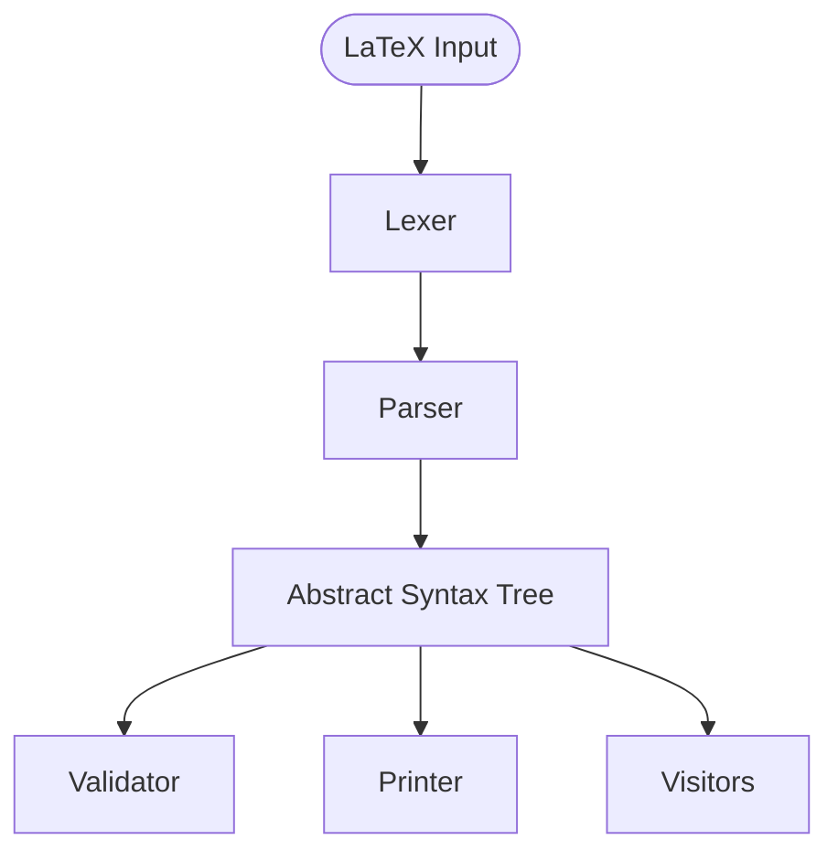

# BML Architecture

This document reflects the current architectural design of Buna's Math Library. It will evolve as subsystems are implemented.

## Current Design

### Components

- **LaTeX Input** — Primary input format. Users write mathematical expressions in LaTeX notation.
- **Lexer** — Tokenizes LaTeX input into a stream of tokens. *(Planned)*
- **Parser** — Converts token stream into an AST. *(Planned)*
- **AST** — Core data structure. All subsystems operate on this shared representation.
- **Validator** — Checks expressions for structural and mathematical validity.
- **Printer** — Produces human-readable output (text, LaTeX). *(Planned)*
- **Visitors** — Traversal framework for operating on AST nodes. *(Planned)*

### Principles

- The AST is the single source of truth. Every subsystem reads from and writes to the same tree structure.
- Nodes are immutable once created. Transformations produce new trees rather than modifying existing ones.
- Operations are expressed as visitors or rewrite rules that pattern-match against AST structures.

---

This document will be updated as new subsystems (rewrite engine, simplifier, optimizer, code generator, etc.) are implemented.
