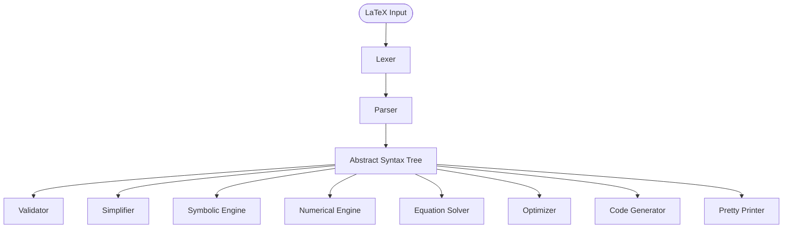

# Buna's Math Library (BML)

> **A symbolic and numerical mathematics framework written in C.**

Buna's Math Library (BML) is an experimental open-source project that aims to build a complete mathematics framework from scratch using modern C and minimal external dependencies.

Unlike traditional math libraries that focus solely on numerical computation, BML is designed to understand mathematics symbolically. Its long-term vision is to provide a reusable library capable of parsing, manipulating, transforming, solving, and evaluating mathematical expressions across a wide range of mathematical disciplines.

BML is designed to serve as a common mathematical foundation for future projects, including physics engines, graphics applications, robotics software, scientific simulations, optimization tools, and other computational systems.

> **Status:** Early experimental design. APIs, architecture, and internal representations are expected to evolve.

---

## Features

### Current

- 🚧 Project architecture
- 🚧 AST design
- 🚧 Parser design
- 🚧 Documentation
- 🚧 Build system

### Planned

- Symbolic Algebra
- Numerical Mathematics
- Calculus
- Linear Algebra
- Geometry
- Trigonometry
- Complex Numbers
- Statistics
- Probability
- Optimization
- Differential Equations
- Coordinate Transformations
- Physics Mathematics
- Units & Dimensional Analysis
- Equation Solving
- Expression Simplification
- Expansion & Factorization
- Code Generation
- LaTeX Import / Export

---

## Design Principles

BML is guided by a few simple principles.

- Minimal external dependencies
- Portable ISO C
- Modular architecture
- Symbolic-first design
- Reusable across projects
- Extensible parser architecture
- Human-readable APIs
- Correctness before optimization

---

## Philosophy

BML is built around one central idea:

> **Mathematical expressions should be treated as structured objects—not merely evaluated as floating-point numbers.**

For example,

```text
3*x^2 + 2*x + 1
```

should not immediately become a numerical value.

Instead, it should become an Abstract Syntax Tree (AST), allowing operations such as

- Differentiation
- Integration
- Simplification
- Expansion
- Factorization
- Variable substitution
- Equation solving
- Numerical evaluation
- Code generation
- Mathematical transformations

All of these operations work from the same internal representation.

---

## Expression Input

BML aims to use **LaTeX mathematics as its primary input language**, allowing equations to be copied directly from lecture notes, textbooks, scientific papers, and documentation.

Example:

```latex
\frac{x^2+1}{\sqrt{x}}
```

instead of requiring a custom mathematical syntax.

Initially, BML will support a carefully selected mathematical subset of LaTeX. Support will gradually expand over time.

Advantages include:

- Copy equations directly from notes.
- Reuse mathematical notation already familiar to scientists and engineers.
- Produce publication-quality LaTeX output.
- Share a common language with documentation and research papers.

---

## Planned Architecture



The AST acts as the heart of the library. Every subsystem operates on the same internal mathematical representation.

---

## Planned Modules

- Core Infrastructure
- Expression Trees (AST)
- Memory Management
- Lexer
- Parser
- LaTeX Frontend
- Symbolic Algebra
- Calculus
- Numerical Analysis
- Linear Algebra
- Matrix Mathematics
- Vector Mathematics
- Geometry
- Complex Numbers
- Differential Equations
- Probability
- Statistics
- Optimization
- Physics Utilities
- Coordinate Systems
- Units & Dimensional Analysis
- Random Number Generation
- Code Generation
- Pretty Printer

---

## Example API

The exact API is still under development, but the intended workflow looks similar to the following:

```c
#include <bml/bml.h>

int main(void)
{
    BML_Context *ctx = bml_create();

    BML_Expr *expr =
        bml_parse(ctx,
            "\\frac{x^2+1}{\\sqrt{x}}");

    BML_Expr *derivative =
        bml_diff(ctx, expr, "x");

    printf("%s\n",
        bml_to_latex(ctx, derivative));

    bml_destroy(ctx);

    return 0;
}
```

---

## Roadmap

### Phase 1 — Core Infrastructure

- [ ] Arena Allocator
- [ ] AST
- [ ] Error System
- [ ] Context Management
- [ ] Basic Testing Framework

### Phase 2 — Parsing

- [ ] Lexer
- [ ] Tokenizer
- [ ] LaTeX Parser
- [ ] AST Builder
- [ ] Pretty Printer

### Phase 3 — Symbolic Mathematics

- [ ] Expression Evaluation
- [ ] Simplification
- [ ] Expansion
- [ ] Factorization
- [ ] Substitution

### Phase 4 — Calculus

- [ ] Differentiation
- [ ] Integration
- [ ] Limits
- [ ] Taylor Series

### Phase 5 — Scientific Mathematics

- [ ] Linear Algebra
- [ ] Geometry
- [ ] Numerical Methods
- [ ] Optimization
- [ ] Differential Equations

---

## Non-Goals

At least during the early stages of development, BML is **not** intended to:

- Replace mature Computer Algebra Systems such as SymPy or Mathematica.
- Implement the entirety of the TeX/LaTeX language.
- Maintain ABI compatibility between experimental releases.
- Prioritize maximum performance over correctness.

---

## Why?

BML exists because building mathematical software provides an opportunity to explore many areas of computer science, including:

- C Programming
- Compiler Design
- Parsing
- Abstract Syntax Trees
- Data Structures
- Numerical Methods
- Symbolic Computation
- Algorithms
- Software Architecture
- Scientific Computing

Whether BML eventually becomes a production-quality mathematics framework or remains an educational experiment, the knowledge gained while building it is the primary objective.

---

## Contributing

BML is currently a personal research and learning project.

Contributions, discussions, bug reports, feature requests, and architectural suggestions are always welcome. As the project matures, contribution guidelines and coding standards will be added.

---

## License

This project will be released under an open-source license.

The specific license has not yet been selected.
