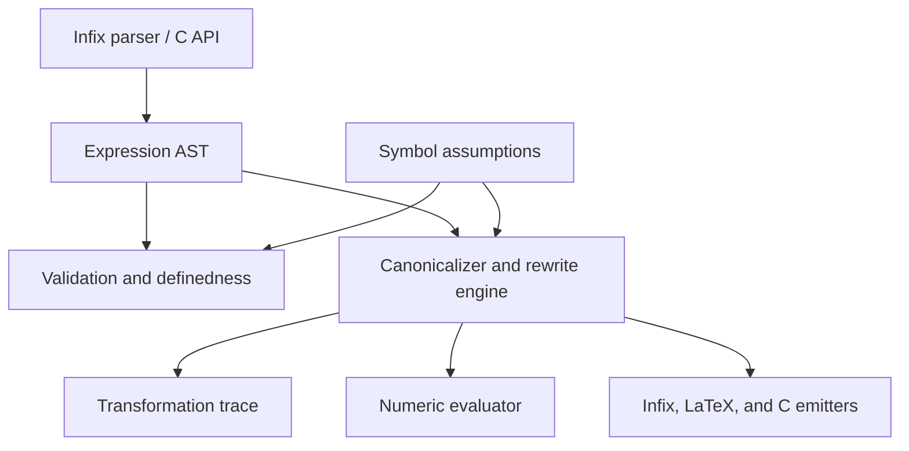

# Target Architecture

## Product Boundary

BML's target is a symbolic optimizer for scalar real-valued expressions. It is
intended to be embedded in C or C++ applications and to demonstrate reliable
symbolic transformation, not to cover every mathematical discipline.

The supported end-to-end path is:

```text
infix input or C API -> AST -> validation -> transformation -> evaluation or C output
```

LaTeX is a future input and output frontend. It is not a prerequisite for the
symbolic core.

## Layers



### Frontends

- A programmatic C API constructs expressions directly.
- A small infix parser is the first textual frontend.
- A LaTeX frontend may map a constrained subset onto the same parser/AST model.

### Semantic Core

- The AST is immutable-by-convention and allocated from a context-owned arena.
- Symbols are resolved through a symbol table and may carry assumptions such as
   real, finite, nonzero, positive, nonnegative, or integer.
- Validation establishes structural correctness; later definedness analysis
  determines whether transformations are valid under available assumptions.

### Transformations

- A local simplifier applies safe rewrite rules bottom-up.
- A canonicalizer gives equivalent arithmetic expressions a deterministic form.
- An optimizer can later select among equivalent forms using a cost model such
  as operation count or generated-code readability.
- An opt-in experimental equality-exploration backend has strict iteration and
  node bounds, and records its limited proof steps; local optimization remains
  the production default.
- Every applied transformation should be recordable as a rule name, input,
  output, and required assumptions.

### Backends

- Numeric evaluation accepts bindings for symbols and reports domain failures.
- Text and LaTeX emitters provide readable representations.
- The C emitter lowers normalized scalar expressions into portable C code.

## Non-Goals

- Full TeX/LaTeX compatibility.
- General equation solving, arbitrary precision algebra, or all mathematical
  domains in the initial product.
- Reordering or rewriting expressions when the required domain assumptions are
  unavailable.
